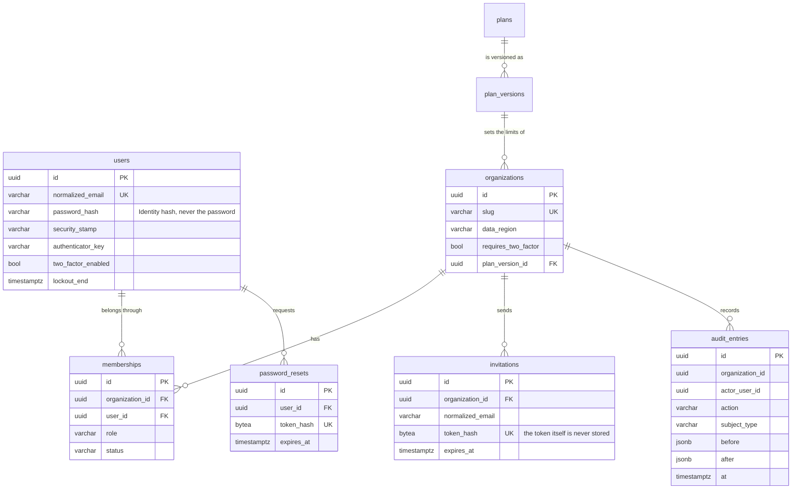
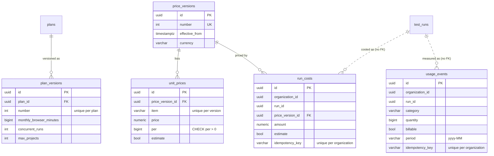
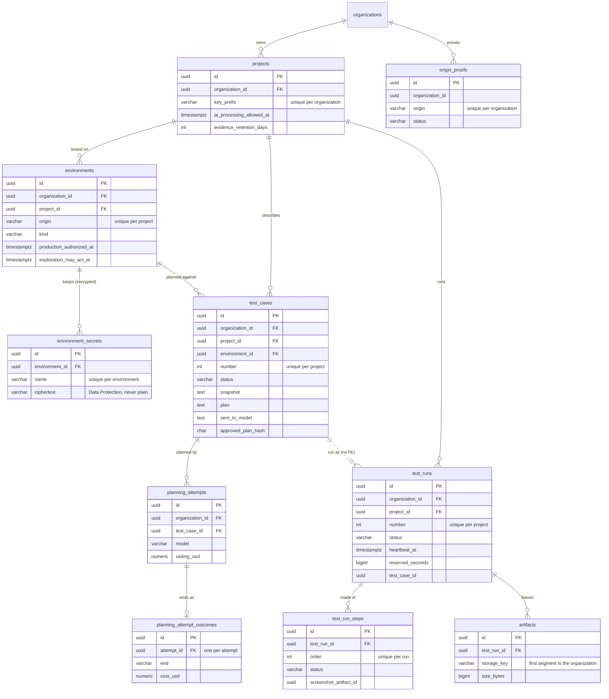

# The database as built

> **What this is.** The schema that exists today, read from a database migrated to the latest migration
> (`KeyRingCanary`, 17 migrations) on 2026-11-26: tables, keys, indexes and the rules that protect the data, with what
> is missing said plainly. **Built, not planned.** The design the schema follows, with stores, lifecycle, volumes and
> backups, is [`data-architecture.md`](data-architecture.md) (ADR-0038). Where the database is going is
> [`business/goal-enterprise-database.md`](business/goal-enterprise-database.md).
>
> Regenerate the facts with the queries in §9 after any migration. A table, index or constraint added or removed
> changes this document in the same commit.

## 1. At a glance

| | |
|---|---|
| Engine | PostgreSQL 16, one database for every tenant (ADR-0012), through EF Core (`Autestiq.Persistence`) |
| Tables | 22, plus EF's `__EFMigrationsHistory` |
| Views | 4 content-free analytics views (`analytics_*`, Milestone 5.1 R6) |
| Schema changes | EF migrations only, applied by the operator's `migrate` (ADR-0039) |
| Size today | A few MB in development; growth estimates are in `data-architecture.md` §6 |

## 2. Conventions every table follows

- **Names** are `snake_case`, set once for the whole model (`SnakeCaseNames`). Constraints are prefixed: `pk_` for
  primary keys, `ak_` for alternate keys, `ix_` for indexes, `fk_` for foreign keys, `ck_` for checks.
- **Primary keys are UUID version 7** (`Entity.Id`). They are random enough to reveal nothing in a URL, but ordered
  by time, so the index does not fragment the way version 4 does. No sequential integers, which would leak how many
  customers and records exist. The numbers people see (`#12`, `SHOP-3`) are a separate column, unique per project.
- **Every row says who wrote it and when**: `created_at`, `created_by`, `updated_at`, `updated_by`. They are set by
  `StampInterceptor`, never by hand.
- **Times are `timestamptz`** (UTC), taken from `TimeProvider`.
- **Enumerations are stored as text** (`varchar`), so a row reads the same in a query as in code. **No CHECK
  constraint holds them to their values yet** (§8).
- **Every text column has a maximum length** except the large documents in `test_cases` (`snapshot`, `plan`,
  `notes`, `sent_to_model`, which are `text`). The audit log's `before` and `after` are `jsonb`.
- **Money is `numeric`**: costs, prices and ceilings. Never a float.

## 3. The tenant boundary

Every table inside the boundary carries `organization_id` and implements `IBelongsToOrganization`. Four
mechanisms hold it, the first three in software:

1. **Query filter.** EF adds `organization_id = <the current organization>` to every query
   (`AutestiqDbContext`). A query that crosses the boundary on purpose says `IgnoreQueryFilters()`, with a comment
   saying why. Background jobs do this, each scoped to one organization at a time.
2. **Save guard** (`TenantGuardInterceptor`). A write to a row of another organization is refused unless the code
   opened a `TenantWriteScope` for it. The same guard refuses to change or delete an append-only row (§6).
3. **Composite foreign keys.** A child points to its parent by `(organization_id, id)`, through an alternate key on
   the parent (`ak_projects_organization_id_id` and the like). The database itself refuses a test run that names
   another organization's project. Not every reference has one yet (§8).
4. **Uniqueness per organization.** Names, numbers and idempotency keys are unique within an organization, never
   globally. Example: `(organization_id, project_id, number)` on test runs.

Outside the boundary, on purpose: `users` (a person can belong to several organizations), `password_resets`, the
plan catalog (`plans`, `plan_versions`), the price book (`price_versions`, `unit_prices`) and `key_ring_canaries`.

**Not built:** PostgreSQL row-level security, and separate database roles. The application connects as one role
that can do anything (R-19; `data-architecture.md` §9).

## 4. The tables, by area

### 4.1 Identity and organizations



### 4.2 Plans, usage and cost



### 4.3 Projects, tests, runs and evidence



A solid line is a foreign key. A dotted line is a reference by id that the database does not enforce (§8).

### 4.4 Every table

| Table | Holds | Inside the boundary | Append-only | Optimistic concurrency (`xmin`) | Deleting the parent |
|---|---|---|---|---|---|
| `organizations` | A customer: slug, region, its plan version | It is the boundary | | ✓ | Plan version: refused |
| `users` | A person's account and Identity fields | No | | ✓ | |
| `memberships` | A person in an organization, with a role | ✓ | | ✓ | Cascades |
| `invitations` | An invitation by email; token stored as a hash | ✓ | | ✓ | Cascades |
| `password_resets` | A reset request; token stored as a hash | No | | | Cascades |
| `audit_entries` | Who did what, to what, when, from where | ✓ | ✓ | | No FK: survives what it describes |
| `plans`, `plan_versions` | The plan catalog (ADR-0028) | No | ✓ | | Refused |
| `price_versions`, `unit_prices` | The price book (ADR-0029) | No | ✓ | | Refused |
| `usage_events` | The usage ledger (ADR-0027) | ✓ | ✓ | | No FK to the run |
| `run_costs` | A run's cost at the price in force (ADR-0029) | ✓ | ✓ | | Price version: refused; no FK to the run |
| `projects` | A product under test | ✓ | | ✓ | Cascades from the organization |
| `environments` | Where a project is tested; production off by default | ✓ | | | Cascades |
| `environment_secrets` | A test account's values, encrypted (ADR-0033) | ✓ | | | Cascades |
| `origin_proofs` | Proof that a customer owns a site (ADR-0026) | ✓ | | ✓ | |
| `test_cases` | A test described in a sentence, its plan and approval | ✓ | | ✓ | Project: cascades; environment: refused |
| `planning_attempts`, `planning_attempt_outcomes` | Each planning call, written before the model is asked (ADR-0037) | ✓ | ✓ | | Refused |
| `test_runs` | A run: status, timing, reservation, cost | ✓ | | ✓ | Cascades from the project |
| `test_run_steps` | A run's steps in order | ✓ | | | Cascades |
| `artifacts` | A stored screenshot's key, type and size | ✓ | | | Cascades |
| `key_ring_canaries` | Proof that the key ring belongs to this database (R-20) | No | | | |

## 5. Indexes

There are 72 indexes: 22 primary keys, 24 more unique indexes, and 26 that only speed up reads. They serve one of four purposes. Every index below exists today.

| Purpose | Examples |
|---|---|
| **Uniqueness the product relies on** (24 unique) | `users(normalized_email)`, `organizations(slug)`, `memberships(organization_id, user_id)`, `projects(organization_id, key_prefix)`, `test_runs(organization_id, project_id, number)`, `test_run_steps(organization_id, test_run_id, order)`, `usage_events(organization_id, idempotency_key)`, `run_costs(organization_id, idempotency_key)`, `invitations(token_hash)`, `password_resets(token_hash)` |
| **Composite keys for the boundary** | `ak_projects_organization_id_id`, `ak_test_runs_organization_id_id`, `ak_test_cases_organization_id_id`, `ak_planning_attempts_organization_id_id` |
| **Lists the product shows** (filter, then order) | `audit_entries(organization_id, at DESC)`, `test_runs(organization_id, project_id, queued_at)`, `test_cases(organization_id, project_id, number)`, `memberships(organization_id, status)`, `usage_events(organization_id, period, category)` |
| **Background jobs** | `test_runs(organization_id, status)` for the queue, `test_cases(status, planning_started_at)` for the planning lease, `origin_proofs(status, check_requested_at)` for proof checks, `artifacts(organization_id, captured_at)` for the retention sweep, `planning_attempts(created_at)` |

**Known gaps:**
- The audit log's person filter (E1.2) matches `actor_email`, which no index covers. The log is small today; the
  index exists for `actor_user_id`.
- Several references by id have no index or no foreign key (§8).
- No index has been checked against a query plan on data of realistic size. That check is technical debt in
  `open-questions.md`.

## 6. How the data is kept right

| Rule | How it is held today | In the database itself? |
|---|---|---|
| A row belongs to one organization and stays there | Query filter, save guard, composite foreign keys | **Partly**: composite FKs yes; the filter and the guard are in the application |
| The ledgers and the audit log are never changed or deleted | `IAppendOnly` refused by the save guard: audit log, usage, costs, plan catalog, price book, planning attempts | **No.** A role with `UPDATE` can still change them (R-19 removes it) |
| Two people saving the same row do not overwrite each other | PostgreSQL's `xmin` as a row version, on 8 tables | Yes |
| A usage event or cost is written once, however often a job retries | Unique `idempotency_key` per organization | Yes |
| Numbers people see are unique per project | Unique indexes | Yes |
| One planning step at a time per deployment | PostgreSQL advisory lock (`AdvisoryLock`, ADR-0037) | Yes |
| A price is per a positive quantity | `ck_unit_prices_per_positive` | Yes, the only CHECK constraint |
| A status, role or kind has one of its values | The C# enum | **No CHECK constraint** |
| A secret is never readable from the database | Encrypted by Data Protection before it is stored; tokens stored as hashes; passwords as Identity hashes | Yes, by never storing the plain value |

## 7. Pagination today

- Lists come back as `PagedResult<T>`: items, total count, page, page size. The query is `ORDER BY …` then
  `OFFSET (page-1)*size LIMIT size`, plus a `COUNT(*)` for the total. The services that page this way are members,
  invitations, runs and the audit log.
- **Page sizes:** the audit log clamps its page size to 1–200. Members, invitations and runs trust the caller, and
  only the pages that call them limit it.
- **Offset is fine at today's size and slows with depth.** Page 1,000 of a large table reads and discards the
  999,000 rows before it, and `COUNT(*)` reads them all. The answer for the long, ever-growing lists (audit log,
  runs, usage) is keyset pagination, set out in the goal document.

## 8. What is missing, read from the schema

What a database review would flag today. Each item is either a known decision or a gap, and says which:

| Finding | Kind | Where it is tracked |
|---|---|---|
| Statuses, roles and kinds are text with no CHECK constraint: a bad write from outside the application is accepted | Gap | Goal D1 |
| `run_costs.run_id`, `usage_events.run_id` and `project_id` have no foreign key | **Decision**: ledgers outlive what they count, as billing records must. Not written down until now | Goal D1 (to confirm in an ADR) |
| `test_runs.test_case_id` and `rerun_of`, and `test_run_steps.screenshot_artifact_id`, have no foreign key | Gap | Goal D1 |
| `test_cases.environment_id` and `environment_secrets.environment_id` point to the environment without `organization_id` | Gap, known for tests | R-18; Goal D1 |
| `audit_entries` has no foreign key to its subject or actor | **Implied decision**: the log is append-only and kept for 2 years (`identity-and-access.md` §4), so it must outlive what it describes. Not written down as such | Goal D1 (to confirm in an ADR) |
| Append-only is enforced by the application only | Gap | R-19; Goal D2 |
| One database role, a superuser in development; no row-level security | Gap | R-19; Goal D2 |
| Offset pagination with full counts; no maximum page size on three services | Gap at scale | Goal D3 |
| No query plan has been checked on realistic data | Debt | `open-questions.md`; Goal D3 |
| `test_cases` holds large documents (`snapshot`, `plan`, `sent_to_model`) in the row | Designed to move out at a measured size | `data-architecture.md` §6 |
| No partitioning | Not needed at today's size | `data-architecture.md` §6; Goal D5 |

## 9. Regenerating these facts

Against a database migrated with `dotnet run --project tools/Autestiq.Operator -- migrate`:

```sql
-- Tables and their column counts
select table_name, count(*) from information_schema.columns
 where table_schema = 'public' group by 1 order by 1;

-- Indexes, and which are unique
select tablename, indexname, indexdef from pg_indexes where schemaname = 'public' order by 1, 2;

-- Foreign keys with their delete rule
select tc.table_name, kcu.column_name, ccu.table_name as references, rc.delete_rule
  from information_schema.table_constraints tc
  join information_schema.key_column_usage kcu using (constraint_name)
  join information_schema.referential_constraints rc using (constraint_name)
  join information_schema.constraint_column_usage ccu using (constraint_name)
 where tc.constraint_type = 'FOREIGN KEY' order by 1;

-- CHECK constraints
select conrelid::regclass, conname, pg_get_constraintdef(oid) from pg_constraint
 where contype = 'c' and connamespace = 'public'::regnamespace;
```
